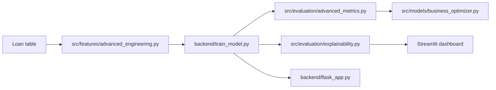
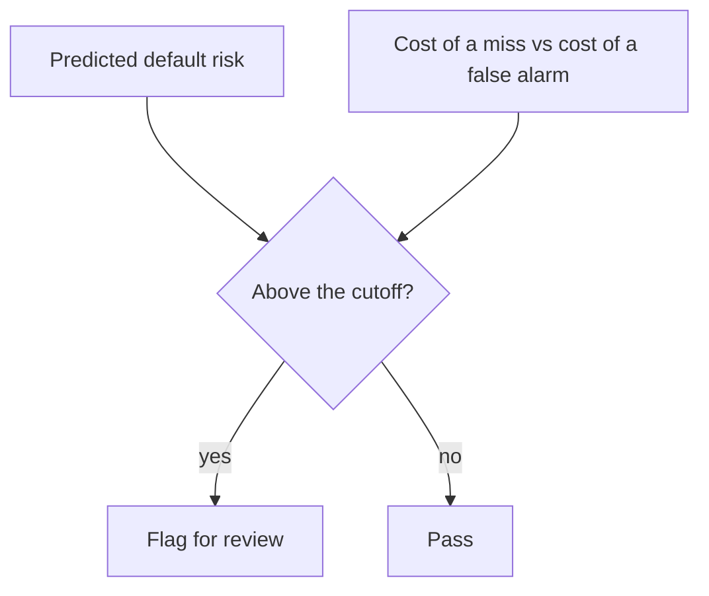

# SBA loan outcome prediction

Models that estimate whether a Small Business Administration loan defaults, then explain the score and connect it to a business decision. This is an analysis of public-style lending data, not a lender.

A default model that cannot say *why* is hard to use. The repository pairs the model with explainability and a small optimizer for the threshold, and it exposes both a Flask API and a Streamlit dashboard.

## Path from table to decision



| Path | What it is |
|---|---|
| `backend/explore_data.py` | First look at the table |
| `backend/train_model.py` | Training entry point |
| `src/features/advanced_engineering.py` | Features beyond the raw columns |
| `src/evaluation/advanced_metrics.py` | Metrics that respect the decision, not only accuracy |
| `src/evaluation/explainability.py` | Why a loan scored the way it did |
| `src/models/business_optimizer.py` | Where to set the cutoff |
| `streamlit_advanced/business_dashboard.py` | The review UI |
| `backend/flask_app.py` | HTTP API around the model |
| `notebooks/model_analysis.ipynb` | The narrative notebook |
| `tests/test_api.py` | API checks |

## What the cutoff is doing



Accuracy hides that tradeoff. `business_optimizer.py` is where the cutoff is chosen. `explainability.py` is what you show a reviewer who has to defend the flag.

## Run it

```bash
python -m venv .venv && source .venv/bin/activate
pip install -r requirements_basic.txt
python backend/train_model.py
streamlit run streamlit_advanced/business_dashboard.py
python backend/flask_app.py
```

`requirements_advanced.txt` and `requirements_flask.txt` cover the dashboard extras and the API.

## What this signals

Credit-style modeling with the parts after the AUC: an explanation, a threshold tied to cost, and an interface someone else can click.
